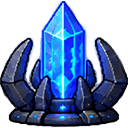

# Obelisk

**Markdown Viewer & Editor**

**[Open Obelisk](https://devilquest.github.io/Obelisk/)**

---

Work in progress...

---

## Credits & Contact 
### Authors
- **Devilquest** - *Lead Developer* - [@devilquest](https://github.com/devilquest)

---

## License
This project is licensed under the [MIT License](LICENSE).

Copyright &copy; 2026 Devilquest.

---

## Donations
**Donations are always greatly appreciated. Thank you for your support!**

